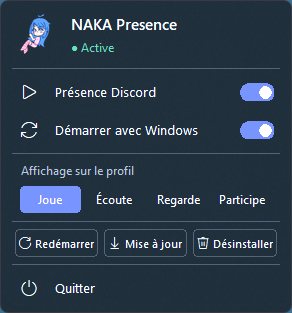

<p align="center">
  
</p>

<h1 align="center">NAKA Presence</h1>

<p align="center">
  Affiche la présence du serveur Discord <b>NAKA</b> sur ton profil, pilotée depuis la zone de notification de Windows ou de Linux.
</p>

<p align="center">
  <a href="https://github.com/Wakizashi2313/naka-presence/releases/latest/download/NakaPresence-Setup.exe"><b>⬇ Télécharger l'installateur</b></a>
  &nbsp;·&nbsp;
  <a href="https://github.com/Wakizashi2313/naka-presence/releases/latest">Notes de version</a>
</p>

<p align="center">
  
</p>

## Fonctionnalités

- **Présence Discord** avec la description du serveur, un minuteur et deux boutons : « Visiter le site » et « Rejoindre le serveur ».
- **Icône dans la zone de notification** : double-clic pour activer ou désactiver, clic droit pour le menu.
- **Type d'affichage au choix** : Joue, Écoute, Regarde ou Participe.
- **Démarrage avec Windows** en option.
- **Accès rapide** aux pages du serveur : site, musique et statistiques.
- **Musique du salon vocal** (option, désactivée par défaut) : quand NakaBOT joue de la musique dans ton salon vocal sur NAKA, ton profil affiche « Écoute <titre> » avec l'artiste, la pochette et la progression. À la première activation, Discord te demande d'autoriser Naka Bot (accès à ton identité seulement).
- **Mises à jour intégrées** : recherche au lancement ou sur demande, pastille quand une version est disponible, installation après confirmation.
- **Légère** : quelques Mo de mémoire au repos.
- **Désinstallation propre** : rien ne reste sur le système.

## Installation

### Windows

1. Télécharge [`NakaPresence-Setup.exe`](https://github.com/Wakizashi2313/naka-presence/releases/latest/download/NakaPresence-Setup.exe).
2. Lance-le. Aucun droit administrateur n'est nécessaire.
3. Garde **Discord pour ordinateur** ouvert (la version navigateur ne fonctionne pas).

> **Windows affiche « Windows a protégé votre ordinateur » ?**
> L'installateur n'est pas signé numériquement, car un certificat est payant. Clique sur
> **Informations complémentaires**, puis sur **Exécuter quand même**. Le code source est
> entièrement disponible ici.

### Linux (Debian, Ubuntu, Fedora…)

**Debian / Ubuntu**

```sh
wget https://github.com/Wakizashi2313/naka-presence/releases/latest/download/naka-presence_all.deb
sudo apt install ./naka-presence_all.deb
```

**Fedora**

```sh
sudo dnf install https://github.com/Wakizashi2313/naka-presence/releases/latest/download/naka-presence.noarch.rpm
```

Puis lance **NAKA Presence** depuis le menu des applications. Discord peut être installé
de n'importe quelle façon : paquet, Flatpak ou Snap.

> **Bureau GNOME (Fedora, Debian) : pas d'icône près de l'horloge ?**
> GNOME n'affiche les icônes de notification qu'avec l'extension *AppIndicator* :
> `sudo apt install gnome-shell-extension-appindicator` (Debian / Ubuntu) ou
> `sudo dnf install gnome-shell-extension-appindicator` (Fedora), puis déconnecte-toi,
> reconnecte-toi et active-la dans l'application **Extensions**. Sans elle, la présence
> fonctionne quand même : relancer **NAKA Presence** depuis le menu des applications
> ouvre son menu. KDE, Xfce et Cinnamon affichent l'icône sans rien installer.

### Prérequis

- Windows 10 ou 11 (64 bits), ou Linux de bureau (Debian 12+, Ubuntu 22.04+, Fedora 39+).
- Discord pour ordinateur, avec **Paramètres → Confidentialité des activités → Partager mon activité détectée** activé.

## Utilisation

| Action | Effet |
|---|---|
| Double-clic sur l'icône (Windows) | Active ou désactive la présence |
| Clic droit sur l'icône (Windows) | Ouvre le menu |
| Clic sur l'icône (Linux) | Menu rapide ; « Ouvrir NAKA Presence » affiche le menu complet |
| Menu → Affichage sur le profil | Choisit « Joue », « Écoute », « Regarde » ou « Participe » |
| Menu → Mise à jour | Cherche une nouvelle version et propose de l'installer |
| Menu → Redémarrer | Relance l'application |
| Menu → Désinstaller (Windows) | Supprime l'application et tous ses fichiers |

Discord n'affiche qu'une mise à jour de présence toutes les 15 secondes environ. Deux changements rapprochés peuvent donc mettre quelques secondes à apparaître.

### Personnaliser les textes

Les réglages sont dans `%APPDATA%\NakaPresence\config.json` (Windows) ou
`~/.config/naka-presence/config.json` (Linux) et sont pris en compte automatiquement en quelques secondes :

| Clé | Rôle |
|---|---|
| `client_id` | Application ID du portail développeur Discord (nom affiché : celui de l'application) |
| `details`, `state` | Les deux lignes de texte (128 caractères maximum chacune) |
| `buttons` | Jusqu'à 2 boutons `{"label": …, "url": …}` (visibles par les autres, pas par toi) |
| `large_image`, `small_image` | Noms des images envoyées dans « Rich Presence → Art Assets » |
| `activity_type` | `0` Joue, `2` Écoute, `3` Regarde, `5` Participe |

## Désinstallation

**Linux** : `sudo apt remove naka-presence` ou `sudo dnf remove naka-presence`. La
configuration (`~/.config/naka-presence`) et le démarrage automatique
(`~/.config/autostart/naka-presence.desktop`) restent dans ton dossier personnel : supprime-les
si tu veux tout effacer.

**Windows** : depuis le menu (**Désinstaller**) ou depuis **Paramètres Windows → Applications installées**. Sont supprimés :

- le dossier de l'application (`%LOCALAPPDATA%\Programs\NAKA Presence`) ;
- la configuration (`%APPDATA%\NakaPresence`) ;
- le raccourci du menu Démarrer ;
- l'entrée « Démarrer avec Windows » du registre ;
- l'entrée de désinstallation du registre.

## Compiler soi-même

Il faut Python 3.12 ou plus récent et [Inno Setup](https://jrsoftware.org/isinfo.php) 6.7 ou plus récent (`winget install JRSoftware.InnoSetup`).

```powershell
.\build.ps1
```

Le résultat est `dist\NakaPresence-Setup.exe`. Pour lancer sans compiler : `python naka_presence.py`.

Paquets Linux : `sh packaging/linux/build.sh` (Python 3 et [nfpm](https://nfpm.goreleaser.com)).
Le workflow `.github/workflows/linux.yml` les construit, les installe et les lance sur
Debian 12, Debian 13 et Fedora, puis les joint à chaque release.

## Licence

[MIT](LICENSE)
